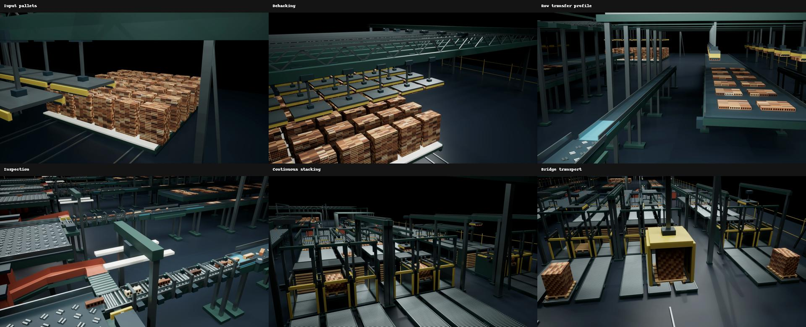
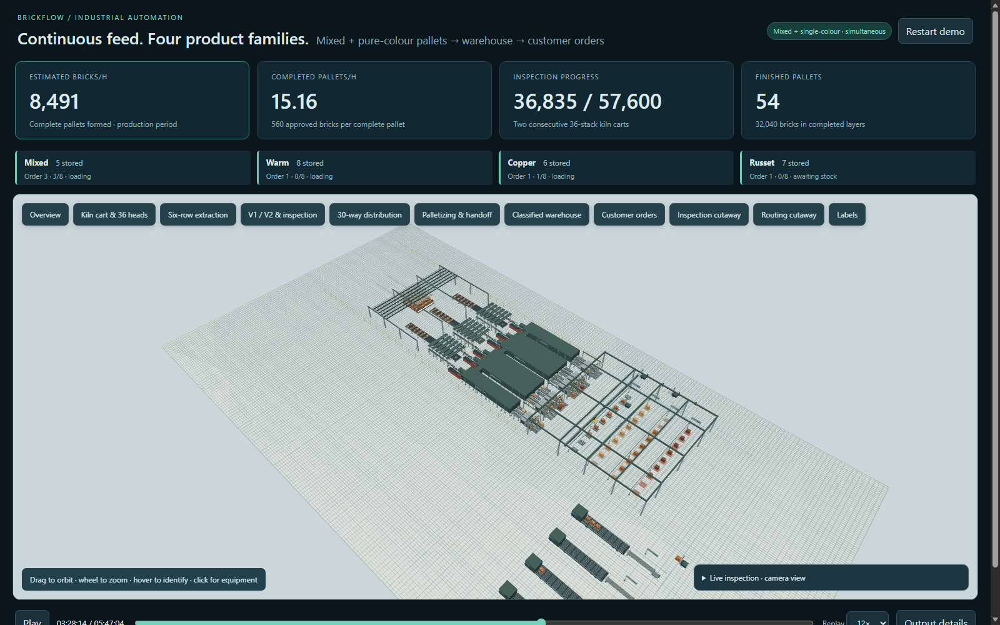

# Brickflow — Robo.Innovate 2026

Industrial brick inspection, sorting and factory automation.

Our flagship deliverable is **Task 3: Brickflow**, a factory simulation developed from a Python/SimPy model into a full-cart interactive factory and a native Unreal Engine production film.

[](https://github.com/Programmercloud-cmd/robo.innovate26/releases/tag/simulation-handoff-20261027)

**[Watch the finished factory film (1080p)](https://github.com/Programmercloud-cmd/robo.innovate26/releases/download/simulation-handoff-20261027/brickflow-continuous-1080p.mp4)** · [All release assets — video, 4K master and Linux build](https://github.com/Programmercloud-cmd/robo.innovate26/releases/tag/simulation-handoff-20261027) · [Explore Task 3](task3/README.md)

## Start here: the factory

| Explore | Where |
| --- | --- |
| Original Python factory simulation | [Python/SimPy model and reproduction instructions](task3/docs/task3_revision14_handoff.md) |
| Latest adapted factory view | [Greenfield 37 layout and recorded replay](task3/docs/greenfield37_layout_handoff.md) |
| Alternate operational model | [Jacob's operational simulation](task3/task3_checkpoint/operational_jacob1/README.txt) |
| Unreal Engine project | [Native C++ simulation, rendering and build guide](task3/unreal/README.md) |
| Output video | [Continuous cinematic workflow](task3/docs/unreal_continuous_film.md) |

To open the recorded Greenfield 37 interactive factory, use Python 3.10+:

```bash
cd task3
python3 scripts/open_cart37_checkpoint.py
```

Open the resulting HTML in a WebGL-enabled browser. The frozen replay does not need Unreal, Isaac Sim or a remote GPU.



## Repository structure

| Project | Description |
| --- | --- |
| [`task3/`](task3/README.md) | Flagship industrial factory: Python models, full-cart WebGL, Unreal project, cinematic, tests and evidence |
| [`task1/`](task1/README.md) | Industrial brick inspection: live YOLO segmentation, tracking and color-based good/bad classification |
| [`task2/`](task2/README.md) | Independent physical Franka LEGO sorting, RGB-D perception, calibration and taught control workstreams |
| [`simulation/`](simulation/README.md) | Separate Isaac Sim / Isaac Lab LEGO digital twin and simulation perception experiments |
| [`docs/`](docs/repository-map.md) | Branch provenance, repository organization and integration status |

Run project commands from the corresponding subdirectory; original handoff instructions refer to that project root. The original branches and release assets remain available.

## What the project demonstrates

The industrial factory simulations model material flow from unloading to inspection, rejection, shade blending, layer formation, storage and dispatch. The original Python model, the later JavaScript event engine and the Unreal C++ engine are related but distinct versions. The delivered Unreal film is based on the pinned revision 30, while the adapted Greenfield 37 replay is a later factory layout.

The camera and physical LEGO sorting workstreams are separate experiments. There is no verified live physical brick-to-Isaac scene synchronization in the archived project. Factory results use synthetic inputs and kinematic assumptions, not measured industrial throughput.

See the [consolidation map](docs/repository-map.md) and [Task 3 guide](task3/README.md) for the exact source snapshots and limitations.
